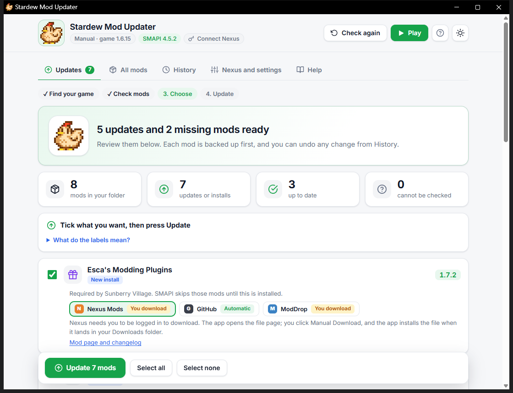

# Stardew Mod Updater

Keep your Stardew Valley mods up to date without opening ten web pages. It checks every mod in your Mods folder, shows you what is out of date, and installs updates with a backup. Free, open source, no ads, no tracking, no account of ours.



## Get it

1. Download the latest zip from the [Releases page](https://github.com/Kkthnx-Stardew/StardewModUpdater/releases).
2. Unzip it and run `StardewModUpdater.exe`. There is nothing to install.

It works on Windows 10 and 11. Windows may show a "protected your PC" notice for an app it has not seen before. Choose "More info", then "Run anyway". Every release includes a `.sha256` file so you can check the download.

## Using it

1. **It checks.** The app finds your game, reads your Mods folder, and asks SMAPI's update service which mods have newer versions. Nothing changes during the check.
2. **You choose.** Each update gets a card. Tick the ones you want. Buttons on the card show where the file will come from.
3. **Press Update.** Each mod is backed up, replaced, and verified. If anything goes wrong, the old version is put back. Every change can be undone from the History tab.

The first launch shows a short tour, and the Help tab has a full guide, an FAQ and fixes for common problems.

| | |
| --- | --- |
|  |  |

## Where files come from

Nexus Mods first, with CurseForge and GitHub as fallbacks when they have the same version. Nexus only gives files to logged-in users, so what happens depends on your setup:

| Your setup | What you do |
| --- | --- |
| Nexus Premium and your key saved in the app | Nothing. Fully automatic. |
| Free account, key saved, "Let this app handle Nexus links" on | One click on Nexus's "Mod Manager Download" button per mod. The app does the rest. |
| No key | The app opens the Nexus page, you press download, and the app installs the file the moment it lands in your Downloads folder. |

To get your key, log in to Nexus Mods, open Site preferences, then API keys, and copy the "Personal API Key". Paste it under "Nexus and settings". It is stored encrypted for your Windows user and only ever sent to Nexus.

Nexus's [API policy](https://help.nexusmods.com/article/114-api-acceptable-use-policy) tolerates personal keys for personal use and asks public apps to register with them. This project has not been registered yet, so use your own key for your own PC only, and never share it. Once registered, a "Log in with Nexus" button will replace pasting a key. Nexus limits each account to 20,000 requests a day (then 500 an hour), and the app uses a few per outdated mod, so normal use stays far below that.

You can also drag any mod `.zip`, `.7z` or `.rar` onto the window. The app shows what it would change and installs it after you confirm.

## What it does to your mods

1. Reads the manifest inside the download. The mod ID must match the mod being updated, or the file is rejected.
2. Zips the old folder into the backup folder.
3. Copies the new files over. Your `config.json` is kept, old `.dll` files the new version dropped are removed, and files you added yourself are left alone.
4. Reads the new manifest back to confirm the version.

It also finds required mods that are missing (the ones SMAPI skips without a clear message) and offers to install them. After you play, it reads SMAPI's own log and tells you which mods failed to load and why, in plain words. You can switch any mod off or on from the All mods tab using SMAPI's folder-name rule (a folder starting with a dot is skipped), and the app warns you first if other mods need it.

## Speed

Measured on a Windows 11 PC with a real 36-mod folder (three runs of the published exe): the window's server is ready in about 0.5 s, the full update check finishes in about 1 s, memory is about 58 MB, and idle CPU is effectively zero. The exe is about 32 MB.

## Safety

- Nothing changes until you press Update, and the game must be closed.
- Archives with paths that try to leave the Mods folder, duplicate entries, or absurd sizes are refused.
- The page is served only on your PC (127.0.0.1) with a random per-run token, and the app talks only to smapi.io, Nexus Mods, CurseForge and GitHub.
- Save games are never touched. See [SECURITY.md](SECURITY.md) for how to report a problem privately.

## The window

The app opens in its own window (no tabs, no address bar) using Microsoft Edge, Chrome or Brave, which are already on your PC. It uses a private profile, so it never touches your browsing. If you would rather use a normal browser tab, change it under "Nexus and settings", or start the app with `--browser`. Closing the window closes the app.

## Command line

```
StardewModUpdater.exe --check              print what is outdated, change nothing
StardewModUpdater.exe --game <folder>      use this Stardew Valley folder
StardewModUpdater.exe --browser            use a normal browser tab
StardewModUpdater.exe --version            print the version
```

Settings, history, backups and logs live in `%LOCALAPPDATA%\StardewModUpdater`. To remove the app, delete the exe and that folder.

## Build from source

You need the .NET 9 SDK.

```
dotnet test tests/StardewModUpdater.Tests
dotnet publish src/StardewModUpdater -c Release -p:PublishSingleFile=true -o artifacts/publish
```

See [CONTRIBUTING.md](CONTRIBUTING.md) for how the code is laid out and how to help.

## Known limits

- CurseForge is read through the same public endpoints its website uses, because its official API needs a key. If that changes, the app falls back to opening the page.
- Mods whose authors left update keys out of the manifest cannot be checked. They are listed so you can see which.
- SMAPI itself is not updated by this app. It tells you when a new version exists.

## License

MIT, see [LICENSE](LICENSE). Third-party components and the logo's origin are listed in [THIRD-PARTY-NOTICES.md](THIRD-PARTY-NOTICES.md). This is a fan-made tool and is not affiliated with ConcernedApe, SMAPI or Nexus Mods.
