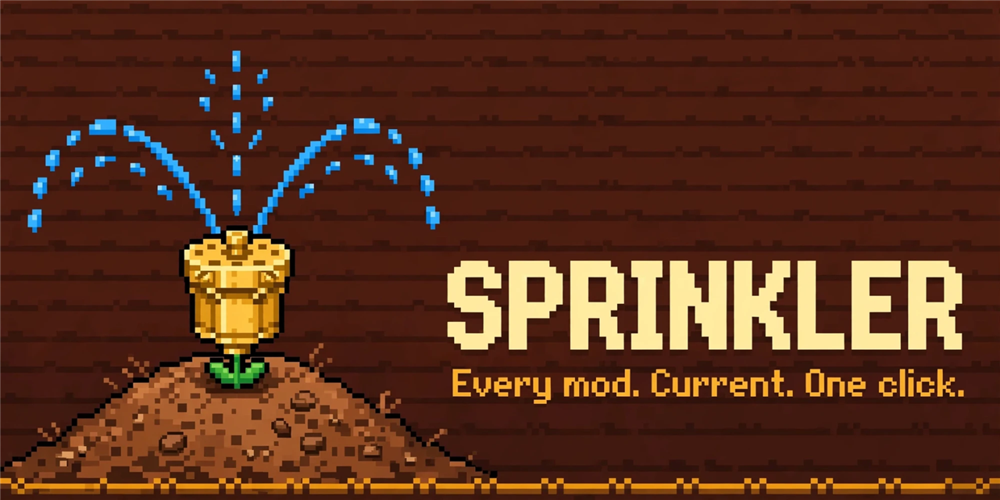
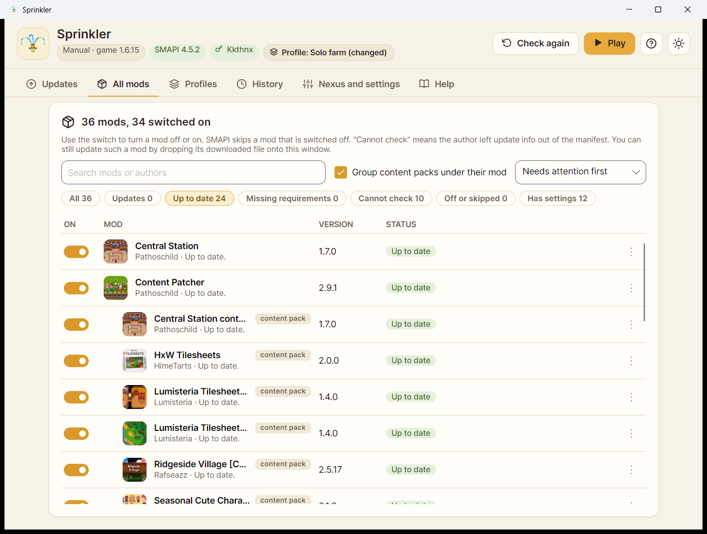
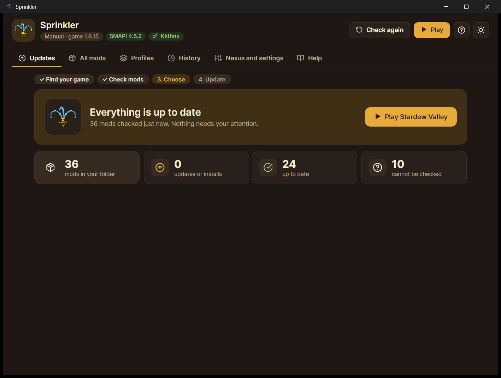
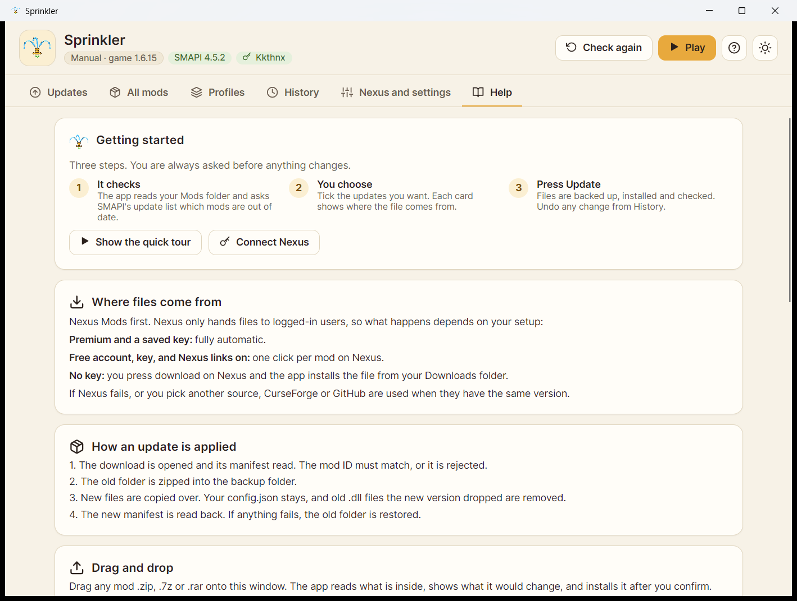
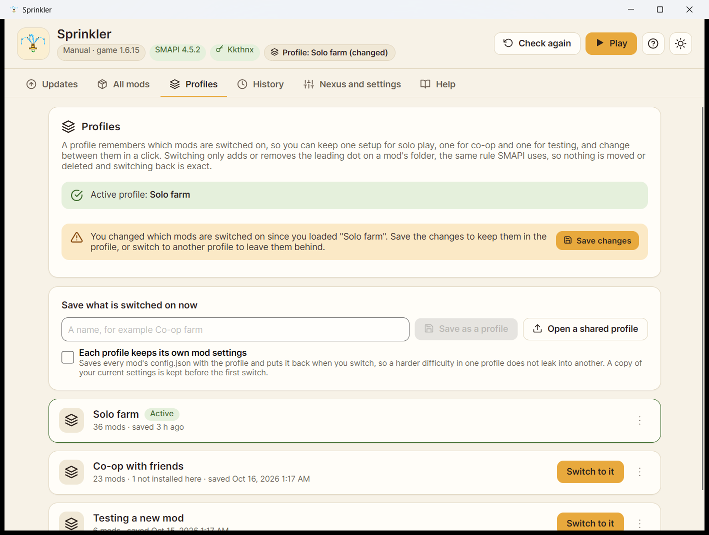

<p align="center"></p>

# Sprinkler

A Stardew Valley mod updater. It checks every mod in your Mods folder, shows what is out of date, and installs updates with a backup. Free, open source, no ads, no tracking, no account of ours.



## Get it

Download the file for your system from the [Releases page](https://github.com/Kkthnx-Stardew/Sprinkler/releases). There is nothing to install and no browser is needed: Sprinkler is a normal desktop program. Every release includes a `.sha256` file so you can check the download.

**Windows 10 and 11.** Unzip it and run `Sprinkler.exe`. Windows may show a "protected your PC" notice for an app it has not seen before. Choose "More info", then "Run anyway".

**Linux, including Steam Deck.** Unpack the `.tar.gz` and run `./Sprinkler` (on the Deck, use Desktop Mode). To start it from your application menu, use **Add to the application menu** under "Nexus and settings", or run `./Sprinkler --install-shortcut` once. It finds Steam (native, Flatpak and extra libraries such as the SD card) and GOG installs by itself.

The Linux build is new and has had less testing than the Windows one. If something does not work, the **Report a problem** button collects what is needed for a bug report.

## Using it

1. **It checks.** Sprinkler finds your game, reads your Mods folder, and asks SMAPI's update service which mods have newer versions. Nothing changes during the check.
2. **You choose.** Each update gets a card with the mod's picture. Tick the ones you want. Buttons on the card show where the file will come from.
3. **Press Update.** Each mod is backed up, replaced, and verified. If anything goes wrong, the old version is put back. Every change can be undone from the History tab.

The first launch shows a short tour, and the Help tab has a full guide, an FAQ and fixes for common problems. Mod pictures and summaries come from Nexus Mods (through your own key) and from GitHub; they are cached for two weeks and are never needed for updating.

| | |
| --- | --- |
|  |  |

## Where files come from

Nexus Mods first, with CurseForge and GitHub as fallbacks when they have the same version. Nexus only gives files to logged-in users, so what happens depends on your setup:

| Your setup | What you do |
| --- | --- |
| Nexus Premium and your key saved in the app | Nothing. Fully automatic. |
| Free account, key saved, "Let this app handle Nexus links" on | One click on Nexus's "Mod Manager Download" button per mod. The app does the rest. |
| No key | The app opens the Nexus page, you press download, and the app installs the file the moment it lands in your Downloads folder. |

To get your key, log in to Nexus Mods, open Site preferences, then API keys, and copy the "Personal API Key". Paste it under "Nexus and settings". It is stored encrypted for your Windows user (on Linux, in your desktop keyring when one is available, otherwise in a file only your user can read) and only ever sent to Nexus.

Nexus's [API policy](https://help.nexusmods.com/article/114-api-acceptable-use-policy) tolerates personal keys for personal use and asks public apps to register with them. This project has not been registered yet, so use your own key for your own computer only, and never share it. Once registered, a "Log in with Nexus" button will replace pasting a key. Nexus limits each account to 20,000 requests a day (then 500 an hour), and Sprinkler uses a few per outdated mod plus one per mod picture every two weeks, so normal use stays far below that.

You can also drag any mod `.zip`, `.7z` or `.rar` onto the window. Sprinkler shows what it would change and installs it after you confirm.

## What it does to your mods

1. Reads the manifest inside the download. The mod ID must match the mod being updated, or the file is rejected.
2. Zips the old folder into the backup folder.
3. Copies the new files over. Your `config.json` is kept, old `.dll` files the new version dropped are removed, and files you added yourself are left alone.
4. Reads the new manifest back to confirm the version.

It also finds required mods that are missing (the ones SMAPI skips without a clear message) and offers to install them. After you play, it reads SMAPI's own log and tells you which mods failed to load and why, in plain words. You can switch any mod off or on from the All mods tab using SMAPI's folder-name rule (a folder starting with a dot is skipped), and the app warns you first if other mods need it.

## Profiles, notes and more

- **Profiles.** Save which mods are switched on as a named profile (solo, co-op, testing) and switch between them in a click. Switching only adds or removes the leading dot on a mod's folder, the rule SMAPI itself uses, so nothing is moved or deleted and switching back is exact. It also turns on whatever the chosen mods need. An optional setting keeps each profile's own `config.json` files, with a copy of your current settings saved before the first switch.
- **Share a profile.** Save a profile as a small file that lists mods, versions and where to get them (never your settings or folders). When a friend opens it, the mods they do not have show up under Updates as installs.
- **Remove with undo.** Removing a mod backs up its folder first and shows it in History with an Undo button that brings it back with its settings.
- **Notes and endorsing.** Keep a private note on any mod, open its settings file, and endorse mods on Nexus from the app (through your own key).
- **A tidier list.** Content packs sit under the mod they belong to, and a filter finds the mods that have settings.



## Speed

Measured on a Windows 11 machine with a real 36-mod folder, using the published single file: the download is about 24 MB (Windows and Linux alike), memory is about 145 MB while the window is open, idle CPU is effectively zero, and the full update check finishes in about 1 second. [docs/ARCHITECTURE.md](docs/ARCHITECTURE.md) explains why Sprinkler is built this way and what the alternatives cost.

## Safety

- Nothing changes until you press Update, and the game must be closed.
- Archives with paths that try to leave the Mods folder, duplicate entries, or absurd sizes are refused.
- Sprinkler talks only to smapi.io, Nexus Mods, CurseForge and GitHub, and only opens links on a short allow-list of those sites.
- Pictures are only stored when the bytes really are an image, under 2 MB, from an allowed site.
- Save games are never touched. See [SECURITY.md](SECURITY.md) for how to report a problem privately.

## Command line

```
Sprinkler --check              print what is outdated, change nothing
Sprinkler --game <folder>      use this Stardew Valley folder
Sprinkler --version            print the version
Sprinkler --install-shortcut   add it to the Linux application menu
```

Settings, history, backups, pictures and logs live in `%LOCALAPPDATA%\Sprinkler` on Windows and in `~/.local/share/Sprinkler` on Linux. To remove the app, delete the program and that folder. If you used the earlier "Stardew Mod Updater" build, Sprinkler carries its settings over the first time it starts.

## Build from source

You need the .NET 9 SDK, on Windows or Linux.

```
dotnet test tests/Sprinkler.Tests
dotnet publish src/Sprinkler -c Release -r win-x64 -p:PublishSingleFile=true -o artifacts/publish
dotnet publish src/Sprinkler -c Release -r linux-x64 -p:PublishSingleFile=true -o artifacts/publish
```

Use the publish line for the system you are building for. See [CONTRIBUTING.md](CONTRIBUTING.md) for how the code is laid out and how to help.

## Known limits

- CurseForge is read through the same public endpoints its website uses, because its official API needs a key. Its mod pictures are not available that way, so those mods show a coloured initial instead.
- Mods whose authors left update keys out of the manifest cannot be checked. They are listed so you can see which.
- SMAPI itself is not updated by this app. It tells you when a new version exists.
- On Linux the Nexus "Mod Manager Download" button works through a desktop entry and needs `xdg-utils`. Without it, use the Manual download button and Sprinkler installs the file from your Downloads folder.
- macOS builds compile but are not released or tested yet, and the Nexus link handler is not available there.

## License

MIT, see [LICENSE](LICENSE). Third-party components and the artwork's origin are listed in [THIRD-PARTY-NOTICES.md](THIRD-PARTY-NOTICES.md). This is a fan-made tool and is not affiliated with ConcernedApe, SMAPI or Nexus Mods.
